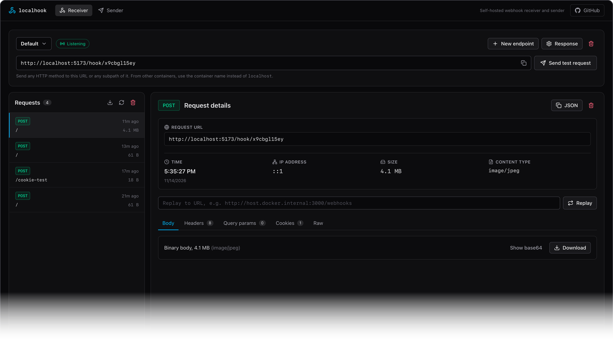
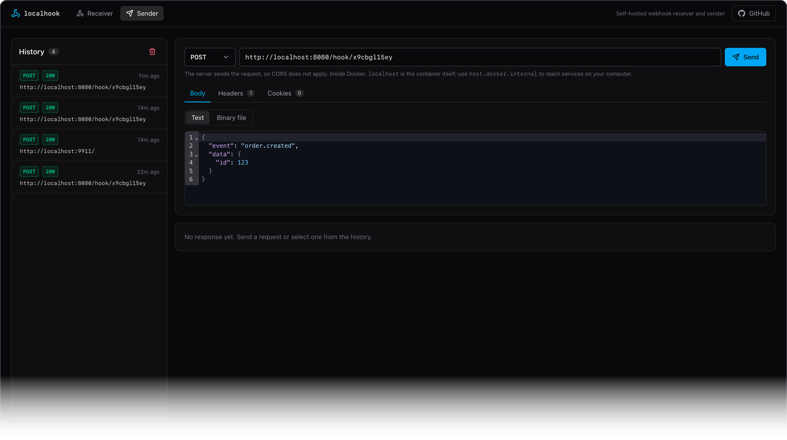

# localhook

A local webhook receiver and sender in one Docker container.

- **Receiver**: create endpoints, send any HTTP method to `/hook/<id>/...`, and inspect each request (headers, query, body, raw JSON) live in the browser. Replay a captured request to another URL.
  - **Auto-forward**: send each captured request to your app as well, with its subpath and query. In **proxy mode**, the sender gets your app's response, so handshakes such as the Slack URL challenge work. Forwards stop after 5 hops (`X-Localhook-Hops` header), so endpoints that forward to each other cannot loop.
  - **Signature check**: verify GitHub, Stripe, Shopify, Slack and Standard Webhooks (Svix) signatures, or a custom HMAC header (SHA-256, SHA-1 or SHA-512, hex or base64) over a payload such as `{header:X-Timestamp}.{body}`. The API returns the secret only on request.
  - **Response rules**: return a different status, body or delay for each method and subpath, e.g. to test retries and timeouts.
  - **Search** by method and by text in the path, headers and body. **Compare** two requests line by line.
  - **Multipart bodies** show as fields and files, with a download for each file.
  - **Import and export** as localhook JSON or HAR.
  - **Copy as cURL**, or open a request in the Sender to change it and send it again.
- **Sender**: send HTTP requests from the server (no CORS limits) and keep a history of responses.
  - **Auth**: Basic, Bearer token or API key (header or query).
  - **Signature**: sign the request like a webhook provider (all schemes above), to test your own signature checks.
  - **Saved requests** in named collections, and **variables** such as `{{baseUrl}}` or `{{token}}`.
  - **Import a cURL command** into the editor, or copy the request as cURL.





## Run with Docker

With the repo checked out:

```sh
docker compose up -d            # pulls katchmk/localhook:latest
docker compose up -d --build    # or builds from source
```

Without the repo:

```sh
docker run -d --name localhook -p 8080:8080 -v localhook-data:/data \
  --add-host host.docker.internal:host-gateway katchmk/localhook:latest
```

Open http://localhost:8080. Data is kept in the `localhook-data` volume.

Images are built for `linux/amd64` and `linux/arm64`. Only a release tag `v1.2.3` builds an image. It gets the tags `1.2.3`, `1.2`, `1`, `latest` and `sha-<commit>`.

Send a webhook:

```sh
curl -X POST http://localhost:8080/hook/<endpoint-id>/orders -H 'content-type: application/json' -d '{"hello":"world"}'
```

Inside the container, `localhost` is the container itself. To send to a service on your computer, use `host.docker.internal`.

## Configuration

| Variable | Default | Description |
|---|---|---|
| `PORT` | `8080` | Server port (API, webhooks and built UI). With Docker, the host port. In dev, also the Vite proxy target |
| `HOST` | all interfaces | Server bind address, for example `127.0.0.1` |
| `WEB_PORT` | `5173` | Vite dev server port (`bun run dev` only) |
| `WEB_HOST` | `localhost` | Vite dev server bind address (`bun run dev` only) |
| `DATA_DIR` | `./data` (`/data` in Docker) | SQLite database directory |
| `MAX_BODY_BYTES` | `10485760` | Maximum captured or response body size |
| `MAX_REQUESTS_PER_ENDPOINT` | `500` | Older captured requests are deleted |
| `MAX_SENT` | `200` | Sender history size |
| `SEND_TIMEOUT_MS` | `30000` | Timeout for sent, replayed and forwarded requests |
| `AUTH_PASSWORD` | none | Turns on HTTP Basic auth for the UI and API. Webhook URLs (`/hook/...`) stay open |
| `AUTH_USERNAME` | `admin` | Basic auth user name |

Set variables in the shell or in a `.env` file in the project root (see `.env.example`). Bun, Vite and Docker Compose all read it.

## Development

Requires [Bun](https://bun.sh) (pinned in `mise.toml`).

```sh
bun install
bun run dev        # API on :$PORT (watch mode) + Vite UI on :$WEB_PORT
bun test           # server tests
bun run typecheck
bun run build      # builds the UI into dist/
```

Stop the container first, or it holds port 8080 (or set a different `PORT`).
